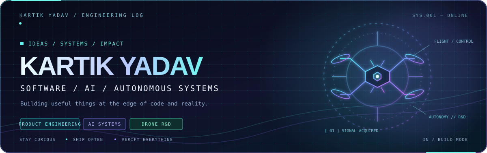

<!--
  PROFILE README FOR: KartikYadav020307
  Copy this README.md into https://github.com/KartikYadav020307/KartikYadav020307
  The contribution snake appears after the included GitHub Actions workflow runs once.
-->

<div align="center">
  

  <br/>

  <a href="https://github.com/KartikYadav020307?tab=repositories">
    
  </a>
  <a href="https://www.linkedin.com/in/kartikyadav2603/">
    
  </a>
  

  <h3>Building useful software. Exploring intelligent systems. Thinking beyond the screen.</h3>

  <p>
    <em>Software engineering · AI experiments · Drone systems · Patent-oriented R&amp;D</em>
  </p>
</div>

---

## `$ whoami`

I'm **Kartik Yadav** — a builder who likes turning ambitious ideas into working systems. My interests span software, AI-powered tools, and the intersection of code with the physical world.

I'm especially interested in projects where **engineering meets real-world impact**: making information easier to verify, building practical digital experiences, and exploring ideas around drone systems and software that may have patent potential.

```text
╭─ CURRENT OPERATING MODE ─────────────────────────────────────────╮
│  BUILD     → Useful products, prototypes, and developer tools    │
│  EXPLORE   → AI workflows, software systems, emerging tech       │
│  RESEARCH  → Drone-related concepts + software innovation        │
│  PRINCIPLE → Make it work. Make it clear. Keep improving it.     │
╰──────────────────────────────────────────────────────────────────╯
```

## ⚡ Selected work

<table>
  <tr>
    <td width="50%" valign="top">
      <h3>🧠 LOCUS · Medical Document Intelligence</h3>
      <p>Evidence-first medical intake: extracts structured facts from medical PDFs and links findings back to their source locations, so a reviewer can verify the evidence instead of taking an AI summary on faith.</p>
      <p><strong>Stack:</strong> Next.js · React · TypeScript · Supabase · Gemini</p>
      <p><a href="https://github.com/KartikYadav020307/medical-intakev3">Explore LOCUS →</a></p>
      <sub>Prototype for document organization and review — not a diagnostic tool.</sub>
    </td>
    <td width="50%" valign="top">
      <h3>🌱 Mental Health Mobile</h3>
      <p>A TypeScript mobile-app project focused on the mental-health space. Visit the repository for its current implementation and project details.</p>
      <p><strong>Stack:</strong> TypeScript · Mobile</p>
      <p><a href="https://github.com/KartikYadav020307/mental-health-mobile">Explore the project →</a></p>
    </td>
  </tr>
  <tr>
    <td width="50%" valign="top">
      <h3>🪄 Hogwarts Hat</h3>
      <p>A Python command-line project that uses student characteristics and CSV data to assign Hogwarts houses, with input validation and grade calculation.</p>
      <p><strong>Stack:</strong> Python · CSV · Testing</p>
      <p><a href="https://github.com/KartikYadav020307/Hogwarts-Hat">Explore the project →</a></p>
    </td>
    <td width="50%" valign="top">
      <h3>🪐 Earth–Mars Website</h3>
      <p>A small static web project built around Earth and Mars, with separate pages and visual assets.</p>
      <p><strong>Stack:</strong> HTML · Web fundamentals</p>
      <p><a href="https://github.com/KartikYadav020307/Earth-Mars-Website">Explore the project →</a></p>
    </td>
  </tr>
</table>

<div align="center">
  <a href="https://github.com/KartikYadav020307?tab=repositories"><b>MORE EXPERIMENTS, CODE & IDEAS →</b></a>
</div>

---

## 🧰 Tools in my recent projects

<p align="center">
  
  
  
  
  
  
  
  
</p>

## 🔭 What I'm exploring

- **AI that can be checked:** source-grounded extraction, document workflows, and useful human-in-the-loop systems.
- **Software innovation:** prototypes and product ideas that solve concrete problems, not just demos that look good.
- **Drone systems & patent-oriented R&D:** exploring concepts spanning drones and software; details stay private while ideas are in development.
- **Better engineering:** readable code, thoughtful UX, testing, and systems that are easier to trust and maintain.

---

## 📊 GitHub telemetry

<div align="center">
  
  
  <br/>
  
</div>

### 🐍 Contribution trail

<div align="center">
  <picture>
    <source media="(prefers-color-scheme: dark)" srcset="https://raw.githubusercontent.com/KartikYadav020307/KartikYadav020307/output/github-contribution-grid-snake-dark.svg" />
    <source media="(prefers-color-scheme: light)" srcset="https://raw.githubusercontent.com/KartikYadav020307/KartikYadav020307/output/github-contribution-grid-snake.svg" />
    
  </picture>
</div>

---

## 🤝 Let’s build something worth shipping

I'm interested in thoughtful collaborations, hackathons, open-source work, research-driven ideas, and conversations about practical AI or software innovation.

<div align="center">
  <a href="https://www.linkedin.com/in/kartikyadav2603/">
    
  </a>
  <a href="https://github.com/KartikYadav020307?tab=repositories">
    
  </a>
  <br/><br/>
  <sub><code>while (curious) { build(); learn(); repeat(); }</code></sub>
</div>

<!-- Keep shipping. The graph will catch up. -->
